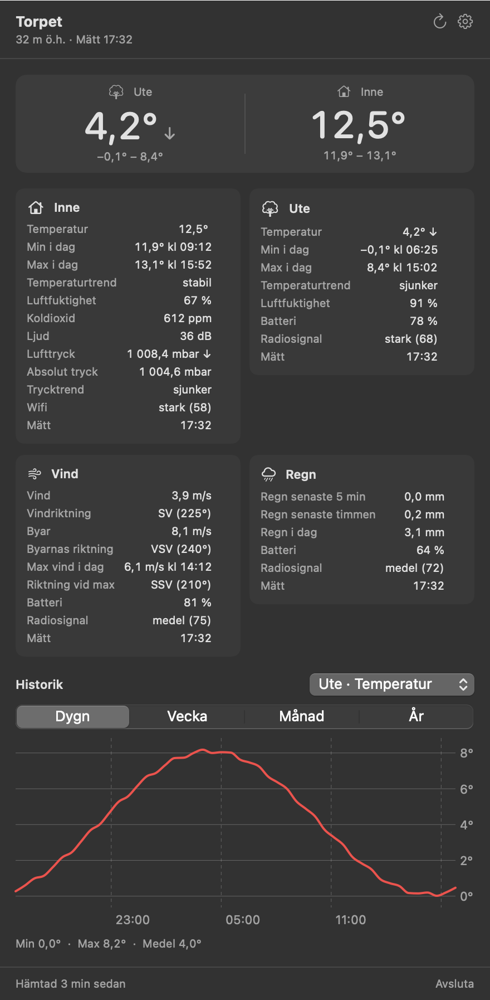

# Torpet

En menyradsapp för macOS som visar temperaturen ute och inne från Netatmo-stationen på torpet, till exempel
`Ute 4,2°  Inne 12,5°`. Klicka på den för att se:

- **Översikt**: ute och inne med trend och dagens min/max.
- **Alla värden** per modul: temperatur, fukt, koldioxid, ljud, lufttryck med trend, vind och byar med riktning,
  regn (5 min, timme, i dag), batteri, signal och när det mättes. Värden som appen inte känner till visas också,
  med Netatmos egna namn.
- **Historik** från Netatmos `getmeasure`, som graf per modul och mätvärde för dygn, vecka, månad eller år. Vid
  månad och år visas temperaturen som dygnets min–max. Regn visas som staplar och vind med byar.

<p align="center"></p>

<sub>Skärmbilden är ritad med exempeldata från `Samples/getstationsdata.json`.</sub>

Data hämtas var tionde minut, eftersom stationen skickar data så ofta, och när popovern öppnas om den senaste
hämtningen är äldre än två minuter.

## Bygga och installera

```bash
./build.sh            # bygger build/Torpet.app
./build.sh install    # lägger den i ~/Applications och startar den
```

Kräver macOS 14 eller senare och Xcode eller Command Line Tools. Under Inställningar (kugghjulet) finns
"Starta vid inloggning".

## Netatmo-nycklar

Appen hämtar på samma sätt som `hammarbynext` (`NetatmoSource.java`): OAuth med refresh-token mot
`api.netatmo.com`, och sedan `getstationsdata`.

1. Gå till <https://dev.netatmo.com/apps/> och öppna appen (samma app som TV:n använder går bra).
2. Kopiera **client ID** och **client secret**.
3. Under **Token generator**: välj scope `read_station` och generera. Kopiera **refresh token**.
4. Klistra in de tre i appens inställningar och tryck Spara.

**Använd en egen refresh-token, inte TV:ns.** Netatmo byter refresh-token vid varje förnyelse. Om två ställen
delar samma token blir det ena utelåst. Appen sparar den nya token varje gång, i
`~/Library/Application Support/Torpet/netatmo.json` (läsbar bara för dig) och läser alltid om filen före en
förnyelse, så två processer på samma Mac kan inte låsa ute varandra. Om Netatmo ändå inte godtar token
visar appen det. Ta då fram en ny token och lägg in den.

## Filer

| Fil | Innehåll |
|---|---|
| `Sources/Torpet/Netatmo.swift` | API-klient, token-förnyelse, tolkning av `getstationsdata` och `getmeasure` |
| `Sources/Torpet/Format.swift` | Svenska etiketter och enheter för alla värden |
| `Sources/Torpet/WeatherStore.swift` | Hämtning med intervall, historik med cache, menyradens text |
| `Sources/Torpet/Views.swift` | Popovern: översikt, moduler, graf, inställningar |
| `Samples/getstationsdata.json` | Exempelsvar för att se layouten utan Netatmo |

Rita popovern med exempeldata till en bild, utan att gå mot Netatmo (bara debug-bygge):

```bash
swift run Torpet --snapshot docs/screenshot.png Samples/getstationsdata.json
```
